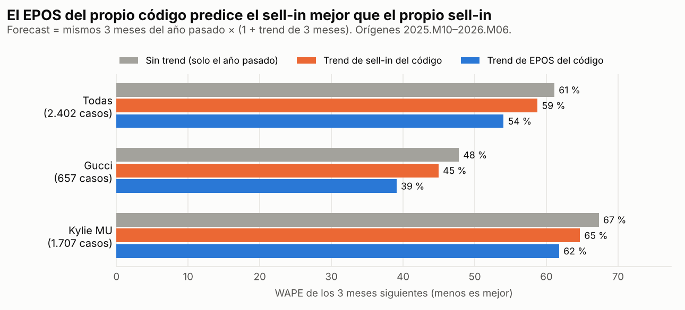
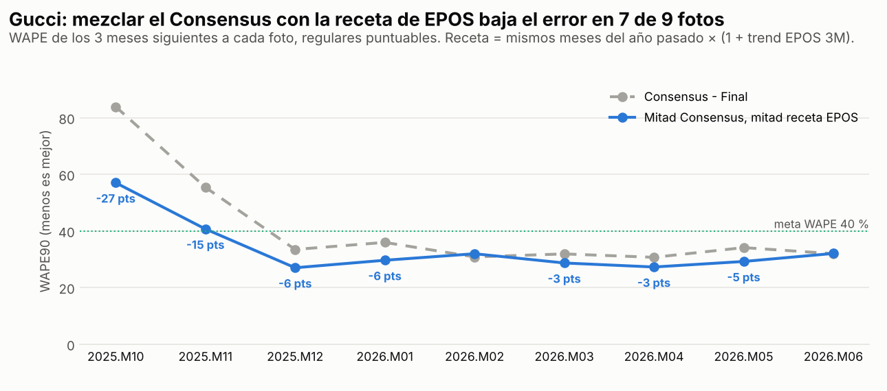
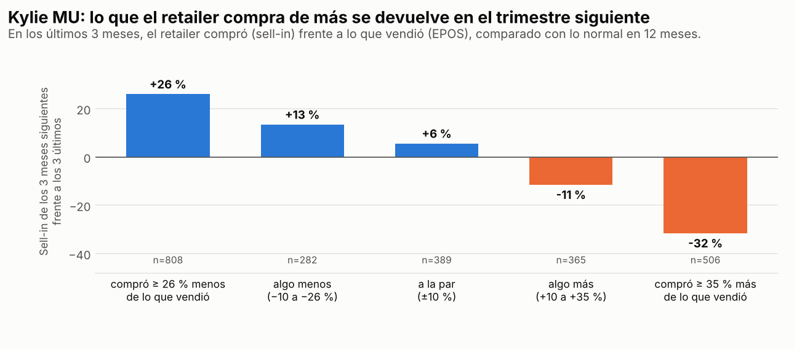
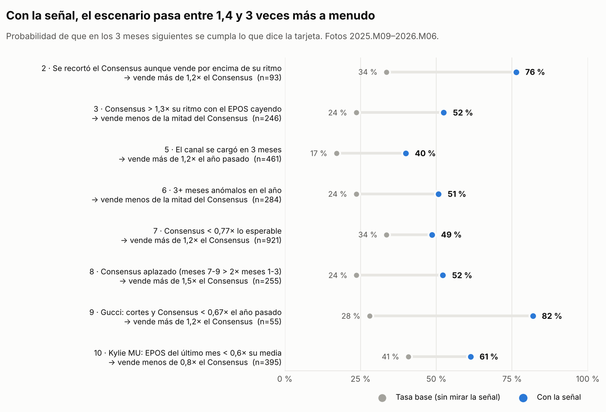

# Patrones en los EANs: qué avisa, en una foto, de lo que va a pasar en los 3 meses siguientes

**Datos:** Gucci, Kylie MU y Kylie Frag, 14 fotos cada una (2025.M09–2026.M10). Burberry, Burberry MU, Gucci MU y Marc Jacobs MU no tienen fotos todavía.

**Qué se mide:** solo los 4 escenarios que pediste, comparando lo vendido (sell-in) en los 3 meses siguientes a la foto con una referencia:

| Escenario | Condición |
|---|---|
| Vende menos | < 0,8 × la referencia |
| Vende mucho menos | < 0,5 × la referencia |
| Vende más | > 1,2 × la referencia |
| Vende mucho más | > 1,5 × la referencia |

La referencia es una de dos:
- **Frente al Consensus (tabla K):** las 10 fotos que ya cerraron sus 3 meses (2025.M09–2026.M06).
  - 2.528 casos (código × foto) de 347 códigos.
- **Frente al año pasado (tabla Y):** cada mes de la historia hace de foto (2024.M03–2026.M06).
  - 5.346 casos.
  - Solo códigos con 24 meses o más, para no comparar con su año de lanzamiento.

**Cómo leer las cifras:** "52 % frente a 24 %" quiere decir que, con la señal, el escenario pasó el 52 % de las veces; sin mirar la señal (la tasa base), el 24 %.

---

## Los 10 hallazgos

### 1. El EPOS del propio código predice el sell-in mejor que el propio sell-in



**La regla:** para el forecast de los 3 meses siguientes como "mismos meses del año pasado × (1 + trend)", el trend que mejor funciona es el **trend de EPOS de 3 meses del propio código, al 100 %**.

WAPE de los 3 meses siguientes:

| | Sin trend | Trend de sell-in | Trend de EPOS |
|---|---|---|---|
| Todas las casas | 61 % | 59 % | **54 %** |
| Gucci | 48 % | 45 % | **39 %** |
| Kylie MU | 67 % | 65 % | **62 %** |

- **Del propio código, no del grupo:** el EPOS del código gana al de su línea (56 %), su brand (58 %) y la casa (61 %).
- **El trend de sell-in a veces empeora:** en Gucci, en las fotos recientes, el forecast sale peor con el trend de sell-in que sin ningún trend (49 % frente a 45 %). El de EPOS siempre mejora.

**Por qué no es obvio:** el EPOS solo se usa para "confirmar" y no está completo (no todos los retailers reportan). Pero para medir la **dirección** no hace falta que esté completo: el sell-in de 3 meses lleva el ruido de los pedidos y el EPOS no.

**Validación:**
- 2.402 casos con EPOS completo (2025.M10–2026.M06).
- Intervalo del 90 % de la mejora, remuestreando códigos: −6,2 a −3,3 puntos (Gucci −8,4 a −3,5; Kylie MU −4,4 a −1,5).
- Gana en la mitad antigua y en la reciente, en las tres casas.

**Acción:**
- En la Brújula 2, probar **mezcla m = 100 % sell-out** con el grupo **Propio**.
- Ojo: aquí solo se midió el trend de 3 meses; el motor usa 6, 9 y 12 meses, y el trend de EPOS de 12 meses todavía no se puede medir (el EPOS empieza en 2024.M07).

### 2. Recortar el Consensus cuando el código vende por encima de su ritmo sale caro

**La regla:** si en la foto se ha recortado el Consensus de los 3 meses siguientes **más de un 15 % frente a la foto anterior y más de un 30 % frente a hace 3 fotos**, y aun así los últimos 3 meses van **por encima de su ritmo de 12 meses**, entonces:
- **76 % vende más de 1,2× el Consensus** (base 34 %);
- la mediana de lo vendido es **2,05× el Consensus**;
- en unidades: 1,54× el Consensus, frente a 0,93× en el resto.

Con el recorte de la foto anterior solo, ya es raro vender menos de 0,8× (26 % frente a 43 %).

**Por qué no es obvio:** el recorte parece prudencia, pero es una sobrerreacción. Las ventas no daban motivo para recortar.

**Validación:**
- 93 casos, 85 códigos distintos, 7 fotos.
- Antiguo 79 % frente a 36 %; reciente 72 % frente a 31 %.
- Gucci 74 % y Kylie MU 81 %.
- Se mantiene sin el código con más casos, sin la línea dominante, sin la foto con más casos, sin las fotos de la ruptura de perímetro y con Consensus grandes (≥ 300 uds: 77 %).
- Barajando la señal dentro de cada foto, el efecto no sale ni una vez en 500 (p < 0,01).

**Acción:**
- Señal nueva para el detector: "Consensus recortado con ventas por encima del ritmo".
- En esos códigos, deshacer el recorte o, como mínimo, volver al ritmo de 12 meses.

**Ejemplos:**
- 4064941155874 KJ MU PLMP LIN LINPEN 1.1G 808 KYLIE (vendió 2,3× el Consensus)
- 4064941078128 KJ MU PLMP GLS 818BUB (5,8×)
- 3616301976134 GG PF21 EDT NS 30 ML (1,9×)

### 3. Consensus por encima de su ritmo mientras el EPOS cae: la mitad vende menos de la mitad

**La regla:** si el Consensus de 3 meses es **más de 1,3× su ritmo de 12 meses** y el **EPOS de los últimos 3 meses cae más de un 10 %** frente al año pasado, entonces:
- **52 % vende menos de la mitad del Consensus** (base 24 %);
- **68 % vende menos de 0,8×** (base 43 %);
- en unidades: 0,62× el Consensus, frente a 0,99× en el resto;
- mediana: 0,48×.

**Por qué no es obvio:** el plan "de recuperación" se apoya en el sell-in o en el plan comercial, mientras el consumidor ya va a la baja. El EPOS lo avisa antes.

**Validación:**
- 246 casos, 130 códigos.
- Antiguo 53 % y reciente 52 %; Gucci 55 % y Kylie MU 52 %.
- Con Consensus grandes, 54 %.
- Aguanta todas las explicaciones aburridas; permutación p < 0,01.

**Acción:**
- Alarma en el detector.
- Si no hay un motivo concreto (lanzamiento, promo firmada), poner el Consensus de 3 meses como mucho en el ritmo de 12 meses.

**Ejemplos:**
- 4064941033622 KJ MU LSE PWD FACE ML 5G 200ST (vendió 0,08× el Consensus)
- 4064941007197 KJ MU M LIQ LIQLPK 500KRISTEN (0,20×)
- 4064941049227 KJ MU CCLER PWR PLUSH 6.5N (0,03×)

### 4. Gucci: la media del Consensus y una receta con EPOS acierta más que el Consensus solo



**La regla:** en Gucci, forecast de 3 meses = **mitad Consensus + mitad (mismos meses del año pasado × (1 + trend EPOS de 3 meses del código))**.
- WAPE90: **33 % frente a 40 %** del Consensus.
- Intervalo del 90 % de la diferencia: −11,4 a −1,1 puntos.
- Mejora en 7 de 9 fotos; en 2026.M02 sale 1 punto peor y en 2026.M06 empata.
- **La ventaja se ha estrechado:** en las fotos de 2026 es de 0 a 6 puntos (en 2025.M10–M11 eran 15–27).
- **En Kylie MU no funciona:** el Consensus solo es mejor (la mezcla empeora 1 a 7 puntos).

**Por qué no es obvio:** la receta sola no le gana al Consensus (38 % frente a 40 %, sin diferencia clara). Pero se equivocan en cosas distintas, así que su media acierta más que cada una por separado.

**Acción:** en Gucci, usar la receta con EPOS como segunda opinión. Donde se separe mucho del Consensus, partir la diferencia o revisar el código.

### 5. Un canal cargado no anuncia un frenazo frente al año pasado, pero sí frente al último trimestre



**La regla, en dos partes:**

*a) Frente al año pasado:* si en los últimos 3 meses **el retailer compró más de un mes de venta de más** (sell-in por encima de lo que dice el EPOS):
- **40 % vende más de 1,2× el año pasado** (base 17 %);
- en unidades: 1,01× frente a 0,63×;
- en Rabbits con la pendiente de 12 meses al alza, **60 % vende más de 1,5×** (base 11 %).

*b) Frente al último trimestre (Kylie MU):*
- tras comprar ≥ 35 % más de lo que vendió, el sell-in del trimestre siguiente cae un **32 %** frente al último;
- tras comprar ≥ 26 % menos, sube un **26 %**;
- a la par, +6 %.
- Ese desfase añade información a la propia subida y bajada del sell-in: coeficiente −0,66, intervalo del 90 % de −0,82 a −0,49.

**Por qué no es obvio:**
- Se suele leer "canal cargado = va a desestockar". La carga es una señal de **crecimiento**: el código gana puntos de venta.
- Lo que sí se corrige es el **trimestre de carga**, que no hay que extrapolar.
- Relacionado: si el sell-in sube más de un 15 % con el EPOS plano, solo el 15 % se hunde a menos de la mitad del año pasado (base 51 %).

**Explicación aburrida que sí tumba una parte:** en **Gucci**, el desfase del canal no añade nada (coeficiente 0,05; intervalo de −0,10 a 0,22). Allí la carga es sobre todo estacional: el retailer carga antes de Navidad y el EPOS sube después (+58 %).

**Acción:**
- No recortar frente al año pasado un código que está cargando.
- Planificar el trimestre siguiente con el ritmo de EPOS, no con el sell-in del trimestre de carga (en maquillaje).

**Ejemplos:**
- 4064941049128 KJ MU CCLER PWR PLUSH 5N (2,7× el año pasado)
- 4064941049043 PWR PLUSH 4W (4,4×)
- 4064941049005 PWR PLUSH 3C (2,0×)

Sin la línea Concealer, la regla se mantiene (+20 puntos sobre la base).

### 6. Series con sobresaltos: el Consensus sobreestima

**La regla:** si el código tuvo **3 o más meses anómalos en el último año**, entonces:
- **51 % vende menos de la mitad del Consensus** (base 24 %);
- en unidades: 0,71× frente a 0,95×.

"Anómalo" = a más de 3 desviaciones robustas (MAD) de su mediana de 12 meses.

Caso extremo: código de 3 años o más, pequeño (< 4.000 uds/año), muy errático, **y el Consensus ya planifica un mes de pedido grande** → **95 % vende menos de la mitad** (base 25 %); mediana 0,06×. Ojo: solo 16 códigos.

**Por qué no es obvio:** el Consensus parece armarse con medias que los picos inflan. En estos códigos, el pico planificado no llega.

**Validación:**
- 284 casos, 104 códigos.
- Antiguo 54 % y reciente 47 %; Gucci 57 % y Kylie MU 51 %.
- Aguanta todas las explicaciones aburridas; permutación p < 0,01.

**Acción:**
- En códigos con sobresaltos, planificar con la mediana, no con la media.
- No planificar picos en códigos pequeños erráticos.

**Ejemplos:**
- 3616303470845 GUCCI FL G MAG RG EDP 150 ML JUMBO (0,08× el Consensus en 10 fotos)
- 4064941130697 KJ MU SPP GLZ 002LIKE MAGIC (0,27×)

### 7. Una base sencilla sirve de barandilla del Consensus

"Lo esperable" = nivel del código en 12 meses × estacionalidad de su brand el año pasado. Sin trend ni juicio.

**La regla:**
- Si el Consensus de 3 meses es **menor que 0,77× lo esperable**: **49 % vende más de 1,2× el Consensus** (base 34 %); en unidades, 1,21× frente a 0,88×.
  - Pasa en el 36 % de los casos: 921 casos, 271 códigos.
- En Gucci, si es **mayor que 1,3× lo esperable**: **63 % vende menos de 0,8×** (base 47 %); en unidades, 0,64×.

**Por qué no es obvio:** con todo lo que sabe el planner, se esperaría que el Consensus le ganara a una cuenta tan simple. Cuando se aleja mucho de ella, la cuenta simple suele tener razón.

**Validación:**
- Antiguo 52 % frente a 36 %; reciente 45 % frente a 31 %.
- Aguanta en las dos casas grandes y en todas las explicaciones aburridas.
- Ojo: el efecto es moderado (+11 puntos de probabilidad prudente).

**Acción:** en el detector, avisar de todo Consensus fuera de [0,77 ; 1,3] × lo esperable.

**Ejemplos:**
- 4064941139454 KJ MU POUT LIN PEN 356SUL (vendió 2,1×)
- 3616304249716 GUCCI BM EDPIN EDP 100 ML (por encima: vendió 0,45×)

### 8. Consensus aplazado: si se mueve volumen a los meses 7–9, los meses 1–3 se quedan cortos

Es tu tarjeta `K_tardio` del motor. Se confirma, y en Kylie MU se refuerza.

**La regla:** si el Consensus de los meses 7–9 es **más de 2× el de los meses 1–3**, entonces:
- **52 % vende más de 1,5× el Consensus** (base 24 %);
- en unidades: 1,35×.

En Kylie MU, con la pendiente de 12 meses al alza: **85 %** (base 26 %), mediana 2,4×.

**Validación:**
- 255 casos, 142 códigos; antiguo 51 % y reciente 54 %.
- Con Consensus grandes, 47 % frente a 21 %.
- Gucci 37 % frente a 19 %.

**Acción:** no aplazar volumen sin un motivo de supply concreto. Planificar el corto plazo con el ritmo.

**Ejemplos:**
- 4064941049104 KJ MU CCLER PWR PLUSH 4.5C (4,1×)
- 4064941155874 KJ MU PLMP LIN 808 KYLIE (2,8×)

### 9. Gucci: después de cortes, el Consensus no debe quedar por debajo del año pasado

**La regla:** en Gucci, si hubo **cortes de más de medio mes de venta en los últimos 3 meses** y el Consensus es **menor que 0,67× lo vendido en esos meses del año pasado**, entonces:
- **82 % vende más de 1,2× el Consensus** (base 28 %);
- mediana 2,0×;
- en unidades: 1,63× frente a 0,84×.

**Por qué no es obvio:** el libro de señales ya decía que los cortes vuelven como pedido (≈ 40 % por unidad cortada). Lo nuevo es que el Consensus **recorta además el plan** después del corte, y es justo entonces cuando más se equivoca.

**Validación:**
- 55 casos, 29 códigos; antiguo 84 % frente a 37 %.
- **El periodo reciente tiene solo 12 casos** (75 % frente a 20 %): hay que volver a medirlo.

**Acción:** tras un corte, mantener el Consensus al menos en el nivel del año pasado.

**Ejemplos:**
- 3614227912274 GUCCI GUILT H EDT 200ML (6,7×)
- 3616302514274 GUCCI BM EDT 30 ML (2,3×)
- 3614227758063 GUCCI G PF EDP 30 ML (2,0×)

### 10. Kylie MU: un mal último mes de EPOS ya avisa

**La regla:** en Kylie MU, si el **EPOS del último mes es menor que 0,6× su media de 12 meses**, entonces:
- **61 % vende menos de 0,8× el Consensus** (base 41 %);
- con Consensus grandes, 71 %;
- en unidades: 0,66× frente a 1,02×.

**Por qué no es obvio:** un solo mes suele parecer ruido, pero en EPOS (sin pedidos de por medio) un mes malo ya es información.

**Validación:**
- 395 casos, 139 códigos.
- Antiguo 69 % frente a 44 %; **reciente 54 % frente a 38 %, más débil**.

**Acción:** revisión rápida del Consensus del código cuando su EPOS del último mes cae por debajo de 0,6×.

**Ejemplos:**
- 4064941008514 KJ MU PWD BL 335BDNBLK (0,11×)
- 4064941011163 KJ MU HIGH GLS ALWSHN002 (0,55×)



---

## Tus tarjetas actuales (detalle en `tarjetas_actuales.csv`)

- **Libro de señales** (analisis/SENALES-2026-10.md), medido ahora en las tres casas y frente a su propio evento: **16 de 17 se confirman**.
  - Débil: M2 (un Rabbit con EPOS ≥ 25 % peor que su brand muere en 6 meses): 14 % frente a 10 %.
  - Las de pedido grande (G1–G4) quedan fuera, como pediste.
- **Motor de escenarios**: 191 combinaciones de tarjeta × escenario.
  - **142 se confirman**: van en la dirección de sus puntos, en las fotos antiguas y en las recientes, con ≥ 5 puntos sobre la base y q < 0,10.
  - **43 son débiles**.
  - **6 van al revés de lo que dicen:**
    - `EP_acel` (EPOS acelera): da +5 a "vende menos" en Gucci, pero vende menos el 36 % frente al 43 %.
    - `K_da_alto` (DA > 40 % del Consensus): cambia de signo entre fotos (antiguo 56 % frente a 44 %; reciente 34 % frente a 42 %).
    - `O_joven` (13–24 meses): da −2 a "vende más", pero vende más el 41 % frente al 34 %.
    - `G_casa_ep_dn` (el EPOS de la casa cae).
- Casi todas las débiles son **trends de grupo**: casa, brand o línea que suben o bajan mueven la probabilidad del código frente a su Consensus apenas ±3 puntos.

---

## Lo que probé y no funcionó

- **Reglas probadas en total: 635.396.**
  - Tabla K: 393.856.
  - Tabla Y: 241.540.
  - Las mismas tarjetas en cada brand, línea, tamaño, segmento, tramo de edad, tramo de volumen, lista de `filters.csv` y sus cruces, solas y en parejas.
- **El embudo:**
  1. 65.800 pasan Benjamini-Hochberg en las fotos antiguas.
  2. 47.683 se repiten en las recientes.
  3. 20.494 mejoran a sus partes (una pareja a cada una de sus señales; una regla de grupo a la general).
  4. 923 quedan después de quitar duplicados.
  5. **637 sobreviven a todas las explicaciones aburridas.**
- **Señales nuevas que no sirven frente al Consensus:**
  - Consensus "congelado" varias fotos.
  - Lanzamiento de un hermano (misma línea y tamaño).
  - Ser líder o único código de la línea.
  - Poca cobertura de EPOS.
  - "La última vez vendió menos de su Consensus": el sesgo a la baja no se repite. El sesgo al alza se repite poco: vender menos de 0,8× pasa el 31 % frente al 43 %, efecto pequeño.
- **Listas de `filters.csv`:** no definen un comportamiento propio. Solo GUCCI Selected aparece, en 7 de las 20.494 reglas con valor añadido.
- **Tamaño:** casi no discrimina: 132 de las 20.494 reglas con valor añadido.
- **Kylie Frag:** con 9 códigos puntuables no tiene reglas propias; solo cuenta como tercera casa al medir la estabilidad.
- **Frente al año pasado, el ciclo de vida lo tapaba todo:** un código de 13–24 meses se compara con su año de lanzamiento. Por eso la tabla Y solo usa códigos de ≥ 24 meses y no usa las señales que miran el mismo trimestre del año pasado (son el denominador del resultado).
- **La mezcla Consensus + EPOS en Kylie MU** empeora (hallazgo 4).

## Cómo se validó (resumen)

1. **Nada del futuro.** Prueba automática: se ponen valores basura en todos los meses ≥ F y se recalculan las señales de la foto F; ninguna cambia.
   - Límite: el segmento y la Disco Date de los orígenes anteriores a 2025.M09 se toman de la primera foto (2025.M09), que es información algo posterior.
2. **Antiguo → reciente.** Se descubre con las fotos antiguas y se comprueba en las recientes:
   - tabla K: hasta 2026.M01 / desde 2026.M02;
   - tabla Y: hasta 2025.M06 / desde 2025.M07 (las de EPOS: hasta 2025.M12 / desde 2026.M01).
3. **Benjamini-Hochberg** sobre todas las reglas de cada tabla, con **casos independientes**: un código cuenta como mucho una vez cada 3 meses, porque sus ventanas de 3 meses se solapan.
4. **Probabilidad prudente** = límite inferior de Wilson al 90 %, con esos casos independientes.
5. **Explicaciones aburridas.** Se repite la regla sin el código con más casos, sin su línea dominante, sin la brand dominante, sin la foto con más casos, sin la casa dominante y (frente al Consensus) sin las fotos de la ruptura de perímetro de 2026.M02. Debe conservar al menos la mitad de su ventaja.
6. **Para los 10 hallazgos, además:**
   - Consensus o año pasado grandes (≥ 300 uds).
   - Impacto en unidades.
   - Permutación de la señal dentro de cada foto (500 veces).

**Límites:**
- Frente al Consensus solo hay 10 fotos (un año), y el EPOS solo existe desde 2024.M07.
- Correlación no es causa: las reglas dicen qué pasa, no por qué.
- Volver a medir con cada foto nueva (los scripts lo repiten).

## Archivos

| Archivo | Qué es |
|---|---|
| `tarjetas_actuales.csv` | tus tarjetas del motor y del libro, con n, probabilidad, base, lift, probabilidad prudente, estabilidad, puntuación y veredicto |
| `tarjetas_nuevas.csv` | las 637 tarjetas que sobreviven a todo, ordenadas por ganancia, con la regla en una frase, grupo, acción y ejemplos |
| `tarjetas_nuevas_todas.csv` | las 923 validadas, incluidas las que tumba una explicación aburrida (y cuál) |
| `perfil_datos.json` | perfil de los datos (paso 1) |
| `graficos/` | los 4 gráficos de este informe |
| `tarjetas_O10.html` | los hallazgos y las 513 tarjetas de clase A que dicen que algo va a pasar (las nuevas y las 8 de antes que siguen en A por ganancia y superan las mismas pruebas; fuera las de «no va a pasar») en una página del estilo de O10, con filtros, búsqueda y ficha de detalle; se abre sin servidor |

Columnas de puntuación de los CSV:
- `puntuacion` y `clase`: tu fórmula (probabilidad prudente × 100; A ≥ 70 y estable, B 55–70).
- `ganancia_pts` y `clase_ganancia`: la propuesta (puntos de probabilidad prudente por encima de la base; A ≥ 20 y estable, B 10–20).
- `direccion`: "pasa" o "NO pasa"; `prob_tarjeta` y `base_tarjeta` están en esa dirección.

**Repetir el análisis** cuando llegue una foto nueva (desde la raíz del repo):

```bash
python -m scripts.patrones_01_perfil
python -m scripts.patrones_02_casos
python -m scripts.patrones_03_reglas
python -m scripts.patrones_04_epos
python -m scripts.patrones_05_tarjetas
python -m scripts.patrones_06_validar
python -m scripts.patrones_07_graficos
python -m scripts.patrones_08_html
```
